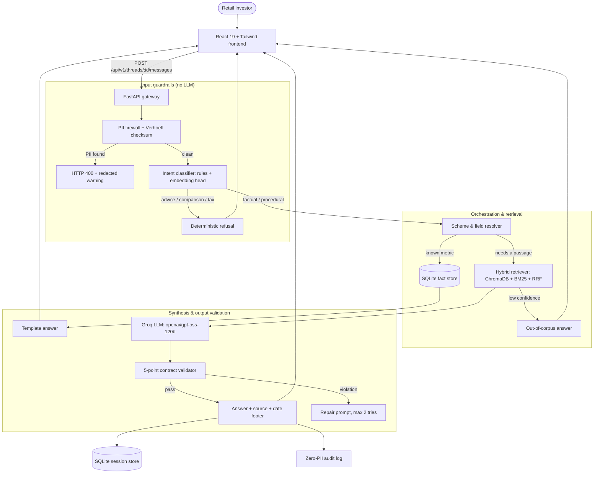
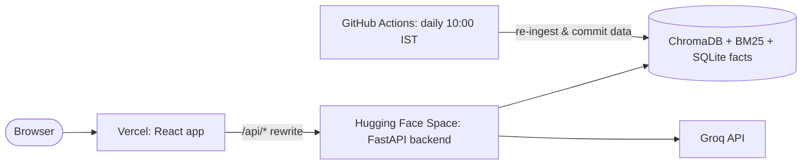

# 📊 Mutual Fund FAQ Assistant (Facts-Only Q&A)

> A retrieval-augmented (RAG) assistant that answers **factual** questions about 5 HDFC Mutual Fund schemes, with Groww as the reference product.
> Guiding principle: **"Accuracy over intelligence"**. Every answer is short, cites one official source and carries a freshness date. It never gives investment advice.

<p>
  <a href="https://mutual-fund-faq-assistant-chi.vercel.app"></a>
  <a href="https://huggingface.co/spaces/deamonizer/mutual-fund-faq-assistant"></a>
</p>

[](https://www.python.org/)
[](https://fastapi.tiangolo.com/)
[](https://react.dev/)
[](https://tailwindcss.com/)
[](https://groq.com/)
[](#-testing--evaluation)
[](#-testing--evaluation)

---

## 🔗 Live Links

| What | URL |
|---|---|
| **Web app** (React, on Vercel) | **https://mutual-fund-faq-assistant-chi.vercel.app** |
| API health check (via Vercel proxy) | https://mutual-fund-faq-assistant-chi.vercel.app/api/v1/health |
| Backend (FastAPI, on Hugging Face Spaces) | https://huggingface.co/spaces/deamonizer/mutual-fund-faq-assistant |

> The backend runs on a free Hugging Face Space, which sleeps when idle. If the first question takes a few seconds, the Space is waking up.

**Try asking:**
- *What is the exit load for HDFC Mid-Cap Opportunities Fund?* → instant fact with source and date
- *What is the expense ratio of HDFC Small Cap Direct Growth?* → instant fact
- *Should I invest in HDFC Small Cap Fund?* → polite refusal (no investment advice)
- *My PAN is ABCPE1234F, show my account* → blocked; personal data is never processed or logged

---

## 📑 Contents

1. [What It Does](#-what-it-does)
2. [Scope: Schemes & Sources](#-scope-schemes--sources)
3. [Response Contract](#-response-contract)
4. [Architecture](#-architecture)
5. [Tech Stack](#-tech-stack)
6. [Testing & Evaluation](#-testing--evaluation)
7. [Run It Locally](#-run-it-locally)
8. [API Examples](#-api-examples)
9. [Repository Layout](#-repository-layout)
10. [Project Docs](#-project-docs)
11. [Known Limitations](#-known-limitations)
12. [Disclaimer](#%EF%B8%8F-disclaimer)

---

## 💡 What It Does

Retail investors and support teams need quick, correct answers to questions like *"What's the exit load?"* or *"What's the minimum SIP?"*. Generic chatbots get these wrong in two ways: they **make up numbers**, and they **slip into investment advice**, which SEBI and AMFI rules prohibit.

This assistant avoids both:
- **Facts come from a fixed corpus**, not the model's memory. Common metrics (TER, exit load, minimum SIP, NAV, benchmark, riskometer, fund manager…) are served straight from a structured fact store in milliseconds.
- **Safety checks are deterministic.** Personal data, advice requests, comparisons, return projections and tax-evasion questions are caught by rules *before* any LLM call.
- **Every output is validated** against a strict contract and repaired or rejected if it fails.

---

## 🎯 Scope: Schemes & Sources

Answers are limited to **5 HDFC Mutual Fund Direct-Growth schemes**:

| # | Category | Scheme |
|---|---|---|
| 1 | Mid-Cap | [HDFC Mid-Cap Opportunities Fund](https://groww.in/mutual-funds/hdfc-mid-cap-fund-direct-growth) |
| 2 | Small-Cap | [HDFC Small Cap Fund](https://groww.in/mutual-funds/hdfc-small-cap-fund-direct-growth) |
| 3 | Large-Cap | [HDFC Top 100 Fund](https://groww.in/mutual-funds/hdfc-large-cap-fund-direct-growth) |
| 4 | Precious Metals FoF | [HDFC Silver ETF FoF](https://groww.in/mutual-funds/hdfc-silver-etf-fof-direct-growth) |
| 5 | Multi-Cap | [HDFC Multi Cap Fund](https://groww.in/mutual-funds/hdfc-multi-cap-fund-direct-growth) |

Refusals and general guidance point to official investor resources: [AMFI Knowledge Center](https://www.amfiindia.com/investor-corner/knowledge-center), [SEBI](https://sebi.gov.in) and [CAMS](https://www.camsonline.com).

Questions about other fund houses (SBI, ICICI, Axis…) get a clear "outside my scope" answer rather than a guess.

---

## 🛡️ Response Contract

Every response follows the same 5 rules, enforced in code:

| # | Rule | How it's enforced |
|---|---|---|
| 1 | **At most 3 sentences** | Sentence counter that doesn't split on decimals (`₹102.50`) or abbreviations (`Rs.`, `vs.`) |
| 2 | **Exactly one source link** | One whitelisted official URL, appended as `Source: <url>` |
| 3 | **Freshness footer** | Last line always matches `Last updated from sources: YYYY-MM-DD` |
| 4 | **No investment advice** | Advisory, comparison, projection and tax-evasion requests get a fixed, non-LLM refusal |
| 5 | **No personal data** | PAN, Aadhaar (Verhoeff-checked), bank account, IFSC, OTP, passwords and folio numbers → HTTP 400, nothing logged |

---

## 🏗️ Architecture

### Request flow



### Deployment



The Vercel app forwards every `/api/*` request to the Hugging Face Space (see [`vercel.json`](vercel.json)), so the browser only ever talks to one domain. A GitHub Actions workflow re-scrapes the sources every day at 10:00 IST and refreshes the indexes ([`.github/workflows/daily-data-ingestion.yml`](.github/workflows/daily-data-ingestion.yml)).

---

## 💻 Tech Stack

| Layer | Choice | Why |
|---|---|---|
| Frontend | **React 19 + TypeScript + Vite** | Fast dev loop and a modern component model |
| Styling | **Tailwind CSS v4** | Dark/light theme, WCAG 2.1 AA contrast |
| State | **Zustand** | Lightweight multi-thread chat state |
| Backend | **FastAPI + Uvicorn** (Python 3.11) | Async REST API with automatic OpenAPI docs |
| Guardrails | **Regex + Verhoeff + embedding intent head** | Deterministic, sub-millisecond safety checks before any LLM call |
| LLM | **Groq `openai/gpt-oss-120b`** | Low latency, temperature 0, used only for passage answers |
| Embeddings | **`sentence-transformers/all-MiniLM-L6-v2`** | 384-dim vectors, fast local inference |
| Vector DB | **ChromaDB** | Persistent index with metadata pre-filtering |
| Keyword search | **BM25 (`rank-bm25`)** | Combined with dense search via Reciprocal Rank Fusion |
| Fact store | **SQLite (`facts.db`)** | Exact canonical metrics in a few milliseconds |
| Sessions | **SQLite (`sessions.db`)** | Multi-thread chat history with per-thread locking |
| Hosting | **Vercel** (frontend) + **Hugging Face Spaces** (backend) | Free tiers; single domain via rewrites |

---

## 🧪 Testing & Evaluation

Results from the latest full run (2026-11-14):

| Check | Target | Result |
|---|---|---|
| Unit & integration tests | all pass | ✅ **412 passed** |
| Adversarial advice-refusal recall (30 prompts) | 100% | ✅ **30/30** |
| Advice requests wrongly answered | 0 | ✅ **0** |
| Personal-data leaks | 0 | ✅ **0** |
| Over-refusal rate (105 benign + held-out queries) | ≤ 5% | ✅ **1.9%** |
| Golden set accuracy (59 queries) | ≥ 95% | ⚠️ **94.9%** (56/59) |
| Benign + held-out pass rate (105 queries) | ≥ 95% | ⚠️ **85.7%** (90/105) |
| Fact-store latency (p50) | < 50 ms | ✅ ~30 ms |

Safety targets are all met. The remaining misses are cautious answers rather than unsafe ones: some harmless questions phrased with advice-sounding words (*"is it wise to check the exit load…"*) get a fact **plus** a refusal note, and a few "not found" cases ask a clarifying question instead. Full reports are in [`eval/reports/`](eval/reports/).

### Run the checks yourself

```bash
cd mutual-fund-faq-assistant

# Unit & integration tests
cd backend && python -m pytest -q && cd ..

# Golden set (59 queries)
python -m eval.run_eval

# Benign, held-out & adversarial sets (105 + 30 queries)
python -m eval.run_benign_eval
```

The eval runners call the API in-process, so no server needs to be running. Set `GROQ_API_KEY` in `backend/.env` first, since a few passage-based answers call the LLM.

---

## ⚡ Run It Locally

**Prerequisites:** Python 3.11+, Node.js 20+, a [Groq API key](https://console.groq.com/keys). Docker is optional.

### Option A: Backend + frontend dev servers

```bash
# 1. Backend
cd backend
python -m venv .venv
source .venv/bin/activate          # Windows: .\.venv\Scripts\activate
pip install -r requirements.txt
cp .env.example .env               # then set GROQ_API_KEY in .env
uvicorn app.main:app --host 0.0.0.0 --port 8000 --reload
```

```bash
# 2. Frontend (new terminal)
cd frontend
npm install
npm run dev
```

- App: http://localhost:5173
- API docs (Swagger): http://localhost:8000/docs

### Option B: Docker Compose

```bash
export GROQ_API_KEY="gsk_..."      # PowerShell: $env:GROQ_API_KEY="gsk_..."
docker-compose up --build -d
```

- App: http://localhost
- Health: http://localhost:8000/health

---

## 📡 API Examples

These run against the **live** deployment. Swap the base URL for `http://localhost:8000` when running locally.

```bash
BASE=https://mutual-fund-faq-assistant-chi.vercel.app
```

<details>
<summary><b>1. Factual question → instant fact-store answer</b></summary>

```bash
curl -X POST $BASE/api/v1/rag/ask \
  -H "Content-Type: application/json" \
  -d '{"query": "What is the exit load for HDFC Mid-Cap Opportunities Fund?"}'
```

Key fields in the response:

```json
{
  "resolution_type": "fact_store",
  "scheme_id": "hdfc_midcap_dg",
  "field": "exit_load",
  "citation_url": "https://groww.in/mutual-funds/hdfc-mid-cap-fund-direct-growth",
  "rendered": "The exit load for HDFC Mid-Cap Opportunities Fund is Exit load of 1% if redeemed within 1 year.\n\nSource: https://groww.in/mutual-funds/hdfc-mid-cap-fund-direct-growth\nLast updated from sources: <date>"
}
```
</details>

<details>
<summary><b>2. Advice request → deterministic refusal</b></summary>

```bash
curl -X POST $BASE/api/v1/rag/ask \
  -H "Content-Type: application/json" \
  -d '{"query": "Should I invest in HDFC Small Cap Fund?"}'
```

```json
{
  "resolution_type": "refusal",
  "text": "I can only provide objective, factual information regarding mutual fund schemes and cannot offer investment advice, comparisons, or recommendations. For guidance on fund selection and financial planning, please consult a SEBI-registered investment advisor or review educational resources.",
  "citation_url": "https://www.amfiindia.com/investor-corner/knowledge-center"
}
```
</details>

<details>
<summary><b>3. Personal data → HTTP 400, nothing logged</b></summary>

```bash
curl -X POST $BASE/api/v1/rag/ask \
  -H "Content-Type: application/json" \
  -d '{"query": "My PAN is ABCPE1234F, show my account details."}'
```

```json
{
  "error": "PII_DETECTED",
  "detected_types": ["PAN"],
  "redacted_text": "My PAN is [PAN_REDACTED], show my account details."
}
```
</details>

**Main endpoints**

| Method | Path | Purpose |
|---|---|---|
| `POST` | `/api/v1/rag/ask` | Single question → validated answer |
| `POST` | `/api/v1/rag/retrieve` | Retrieval only (no LLM), for debugging |
| `POST` | `/api/v1/guardrails/scan` | Run only the PII & intent checks |
| `POST` / `GET` | `/api/v1/threads` | Create / list chat threads |
| `GET` / `DELETE` | `/api/v1/threads/{id}` | Read / delete a thread |
| `POST` | `/api/v1/threads/{id}/messages` | Send a message in a thread (used by the web app) |
| `GET` | `/api/v1/health` | Health and model info |

The API allows 20 requests per minute per IP and rejects queries longer than 1,000 characters.

---

## 📁 Repository Layout

```
mutual-fund-faq-assistant/
├── backend/
│   ├── app/
│   │   ├── api/          # Routers: threads, rag, guardrails
│   │   ├── audit/        # Zero-PII audit logger
│   │   ├── core/         # Settings & configuration
│   │   ├── guardrails/   # PII firewall, intent classifier & head, refusals, validator
│   │   ├── rag/          # Retriever, fact store, entities, glossary, procedures, synthesizer
│   │   ├── schemas/      # Pydantic request/response models
│   │   ├── sessions/     # SQLite thread store
│   │   └── main.py       # FastAPI entrypoint (rate limit, input guard)
│   ├── tests/            # 412 pytest tests
│   └── requirements.txt
├── frontend/             # React 19 + Vite + Tailwind v4 app (deployed to Vercel)
├── ingest/               # Fetchers, parsers, chunker, embedder, fact extractor
├── data/                 # Corpus manifest, indexes (Chroma, BM25, facts.db), prototypes
├── eval/
│   ├── datasets/         # Golden, benign/held-out, adversarial and holdout sets
│   ├── reports/          # Latest evaluation reports
│   └── run_eval.py …     # Evaluation runners
├── docs/                 # Specs: problem statement, architecture, plan, edge cases, evals, deployment
├── .github/workflows/    # Daily data-ingestion pipeline
├── app.py                # Hugging Face Space entrypoint
├── vercel.json           # Vercel build + /api proxy to the Space
└── docker-compose.yml
```

---

## 📚 Project Docs

| Doc | What's in it |
|---|---|
| [Problem statement](docs/problemStatement.md) | Goals, scope and hard requirements |
| [Architecture](docs/architecture.md) | Components, data model, pipelines and design decisions |
| [Implementation plan](docs/implementation-plan.md) | Phase 0–8 build plan with acceptance criteria |
| [Edge cases](docs/edge-case.md) | Edge-case catalogue with stable IDs |
| [Evaluation plan](docs/eval.md) | Per-phase evals and pass criteria |
| [Deployment plan](docs/deployment-plan.md) | Hosting options, env vars and step-by-step deploy |

---

## ⚠️ Known Limitations

- **Narrow scope by design:** only the 5 HDFC schemes above. Everything else gets a "not covered" answer.
- **Cautious wording handling:** harmless questions phrased with words like *"recommend"*, *"wise"* or *"better"* may get a fact plus a refusal note.
- **Data freshness** depends on the daily ingestion job; the footer date shows exactly when the sources were last read.
- **Cold starts:** the free Hugging Face Space sleeps when idle, so the first request after a while is slower.

---

## ⚖️ Disclaimer

This project is for educational and informational purposes only. It is a facts-only Q&A assistant that uses Groww as reference context. It is **not investment advice**, financial solicitation or portfolio management. Mutual fund investments are subject to market risks; read all scheme-related documents carefully.

Licensed under the [MIT License](https://opensource.org/licenses/MIT).
