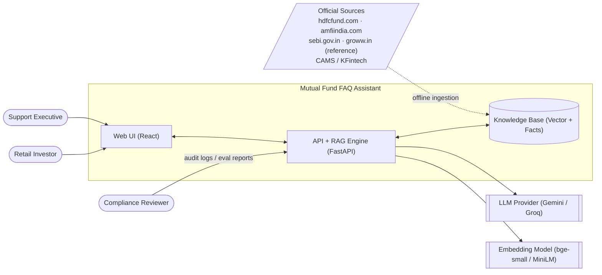
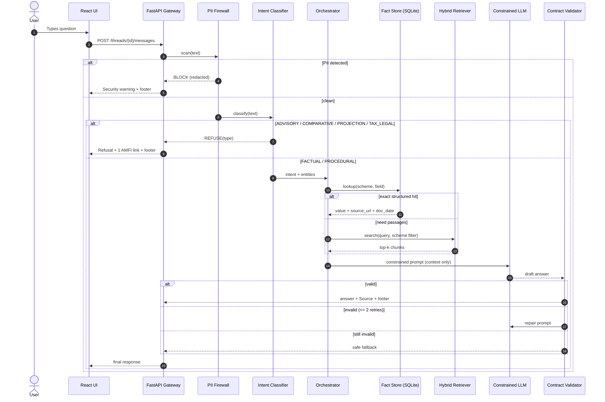
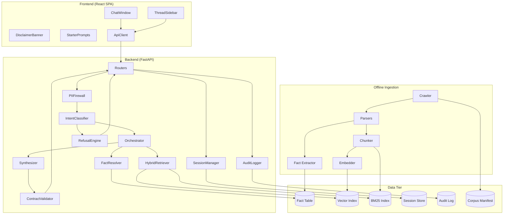
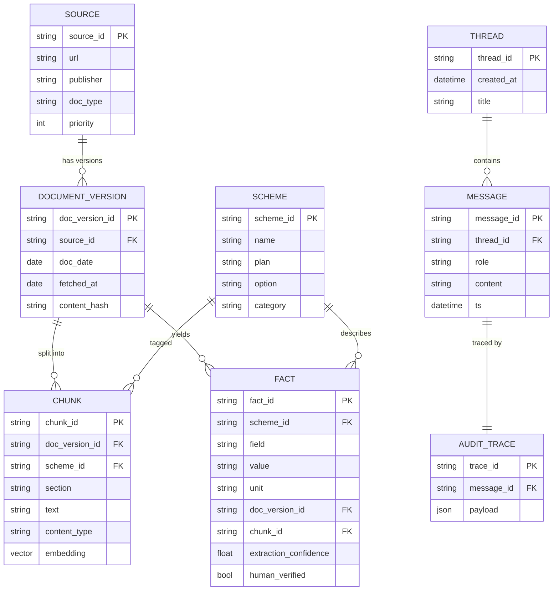
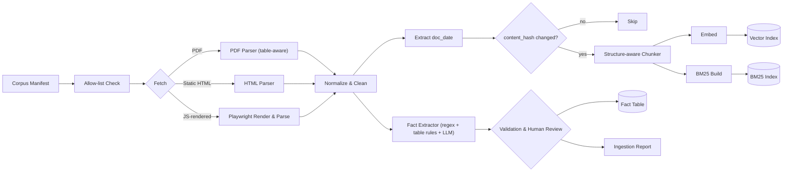
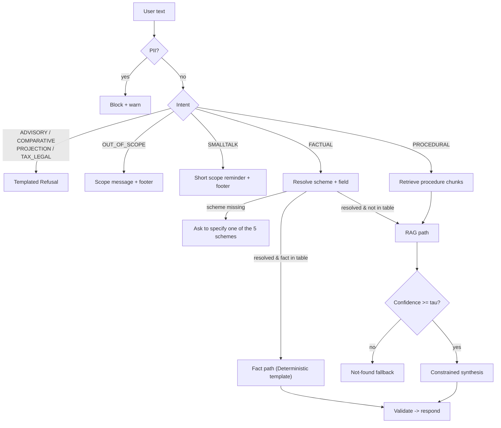
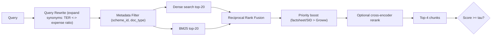
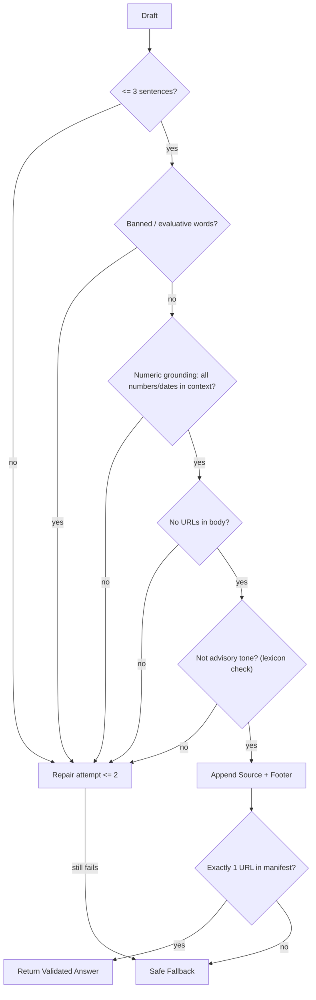
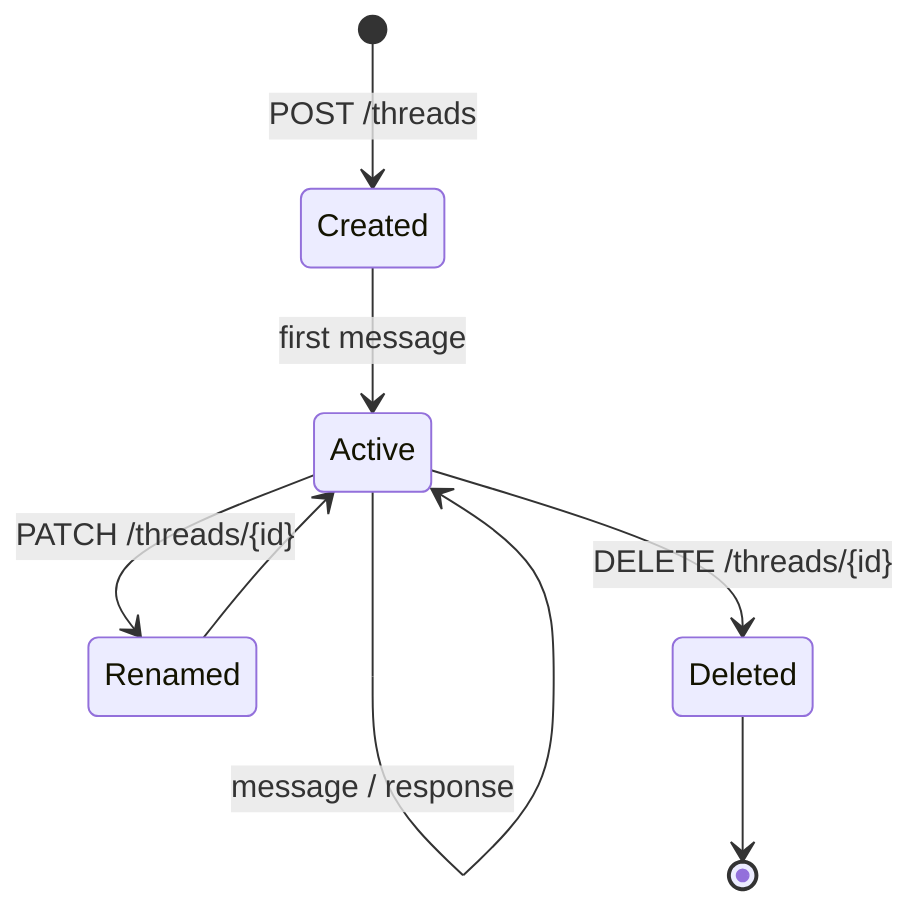
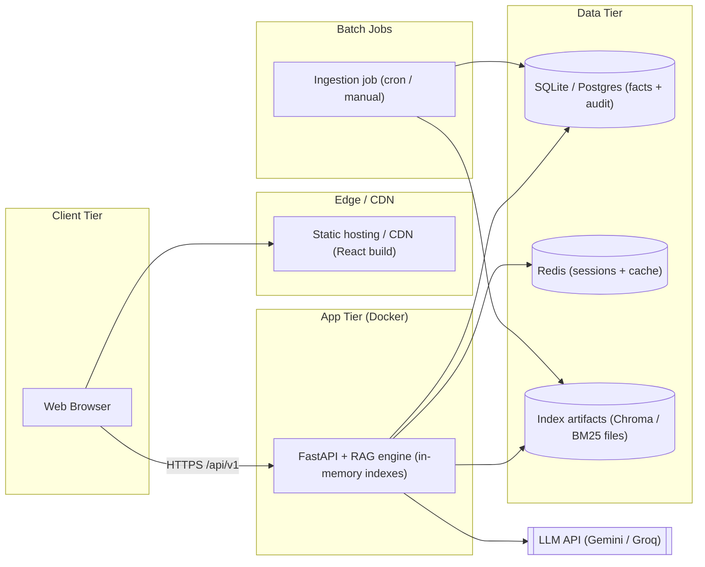

# 🏗️ Mutual Fund FAQ Assistant — Technical Architecture Document

> **Core Principle**: *"Accuracy over Intelligence"*  
> **Scope**: HDFC Mutual Fund · 5 Selected Schemes · Facts-Only · Single-Citation · Zero Advice  
> **Companion Document**: [`problemStatement.md`](./problemStatement.md) (Requirements)  
> **Reference Context**: Groww-style Retail Mutual Fund Platform  

---

## Table of Contents

1. [Architectural Goals & Design Principles](#1-architectural-goals--design-principles)
2. [System Context & High-Level Architecture](#2-system-context--high-level-architecture)
3. [Technology Stack](#3-technology-stack)
4. [Component Architecture](#4-component-architecture)
5. [Data Architecture](#5-data-architecture)
6. [Ingestion Pipeline (Offline)](#6-ingestion-pipeline-offline)
7. [Query Pipeline (Online)](#7-query-pipeline-online)
8. [Guardrail Layer](#8-guardrail-layer)
9. [Retrieval Strategy](#9-retrieval-strategy)
10. [Answer Synthesis & Response Contract Enforcement](#10-answer-synthesis--response-contract-enforcement)
11. [Session & Thread Management](#11-session--thread-management)
12. [API Design](#12-api-design)
13. [Frontend Architecture](#13-frontend-architecture)
14. [Security & Privacy Architecture](#14-security--privacy-architecture)
15. [Performance & Latency Budget](#15-performance--latency-budget)
16. [Observability & Auditability](#16-observability--auditability)
17. [Testing & Evaluation Strategy](#17-testing--evaluation-strategy)
18. [Deployment Architecture](#18-deployment-architecture)
19. [Repository Structure](#19-repository-structure)
20. [Failure Modes & Mitigations](#20-failure-modes--mitigations)
21. [Known Limitations & Future Enhancements](#21-known-limitations--future-enhancements)
22. [Architecture Decision Records (ADRs)](#22-architecture-decision-records)

---

## 1. Architectural Goals & Design Principles

| # | Principle | Implication |
|---|---|---|
| **P1** | **Deterministic over generative** | Wherever a fact can be looked up in a structured record, do that instead of asking an LLM to "recall" it. The LLM is a phrasing layer, never a knowledge layer. |
| **P2** | **Fail closed** | If retrieval confidence is low, the source is missing, or the output violates the contract $\rightarrow$ return a safe *"not found in official sources"* response. Never guess. |
| **P3** | **Guardrails before and after the model** | Input is classified before retrieval (advice / PII / factual). Output is validated after generation (sentence count, URL, footer, banned words, numeric grounding). |
| **P4** | **Every claim is traceable** | Each answer carries `chunk_id` $\rightarrow$ `document` $\rightarrow$ `URL` $\rightarrow$ `document_date`. Numbers must appear verbatim in retrieved context. |
| **P5** | **Single source of truth per fact** | One canonical, version-dated source per fact field; conflicts are resolved by a documented source-priority order, not by the model. |
| **P6** | **Stateless core, isolated sessions** | The RAG engine is stateless; conversation state lives only in per-thread session storage and never leaks across threads. |
| **P7** | **Lightweight** | Runs locally with a single command; in-memory/embedded vector index is sufficient for a corpus of $\le 25$ sources. |

---

## 2. System Context & High-Level Architecture

### 2.1 Context



### 2.2 Layered Architecture

```
┌────────────────────────────────────────────────────────────────────────┐
│ L1 PRESENTATION    React SPA · thread sidebar · chat · disclaimer      │
├────────────────────────────────────────────────────────────────────────┤
│ L2 API GATEWAY     REST/SSE · validation · rate-limit · CORS           │
├────────────────────────────────────────────────────────────────────────┤
│ L3 INPUT GUARDS    PII firewall → Intent classifier → Router           │
├────────────────────────────────────────────────────────────────────────┤
│ L4 ORCHESTRATION   Query planner · scheme/field resolver               │
├────────────────────────────────────────────────────────────────────────┤
│ L5 RETRIEVAL       Structured Fact Store ▸ Hybrid (BM25 + Dense)       │
├────────────────────────────────────────────────────────────────────────┤
│ L6 SYNTHESIS       Constrained LLM (or deterministic templates)        │
├────────────────────────────────────────────────────────────────────────┤
│ L7 OUTPUT GUARDS   Contract validator · numeric grounding check        │
├────────────────────────────────────────────────────────────────────────┤
│ L8 DATA            Vector index · Fact table · Session store           │
├────────────────────────────────────────────────────────────────────────┤
│ L9 OFFLINE         Crawler · Parser · Chunker · Embedder · Evals       │
└────────────────────────────────────────────────────────────────────────┘
```

### 2.3 End-to-End Request Flow



---

## 3. Technology Stack

| Layer | Choice | Rationale |
|---|---|---|
| **Frontend** | React 18 + TypeScript + Vite, Tailwind CSS | Fast dev loop; Tailwind makes WCAG-AA, dark/light theming with emerald accents simple. |
| **State (FE)** | Zustand (or React Context + reducer) | Lightweight multi-thread state; no heavy boilerplate. |
| **Backend** | Python 3.11 + FastAPI + Uvicorn | Best RAG ecosystem; async + SSE streaming; Pydantic for strict schemas. |
| **Ingestion fetch** | `httpx` + `Playwright` (for JS-rendered Groww pages) | Groww scheme pages render client-side; PDFs fetched directly via `httpx`. |
| **Parsing** | `pdfplumber` / `PyMuPDF` (PDF tables), `selectolax` / `BeautifulSoup` (HTML) | Factsheet tables need table-aware extraction. |
| **Chunking** | Custom structure-aware chunker | Preserves table rows and section headings; avoids splitting a number from its label. |
| **Embeddings** | `BAAI/bge-small-en-v1.5` (local) or `all-MiniLM-L6-v2` | Small, fast, no data leaves the machine in local mode. |
| **Vector store** | ChromaDB (embedded, persistent) or FAISS + SQLite | $\le 25$ sources $\approx$ a few thousand chunks — no need for a managed external DB. |
| **Lexical index** | `rank_bm25` (in-memory) | Exact-match strength for numbers, scheme names, "exit load", "SIP". |
| **Reranker (optional)** | `bge-reranker-base` cross-encoder | Improves precision on top-k; skipped if latency is tight. |
| **Fact store** | SQLite (facts table) | Deterministic structured lookups with provenance. |
| **Session store** | SQLite (dev) $\rightarrow$ Redis (prod) | Per-thread isolation; TTL support. |
| **LLM** | Small/fast instruction model (Gemini 3.8 Flash / Claude Haiku / GPT-4o-mini / Groq Llama 3.3), `temperature=0` | Low latency, deterministic phrasing. |
| **PII detection** | Regex + checksum validators (+ optional Presidio) | Deterministic, auditable, India-specific patterns (PAN, Aadhaar, Folio). |
| **Testing** | `pytest`, `promptfoo` / custom eval harness, `Playwright` E2E | Golden-set evaluation + contract tests. |
| **Packaging** | Docker Compose | One-command local run. |

---

## 4. Component Architecture



### 4.1 Component Responsibilities

| Component | Responsibility | Inputs $\rightarrow$ Outputs |
|---|---|---|
| **Routers** | HTTP/SSE endpoints, request validation (Pydantic), rate limiting | HTTP $\rightarrow$ typed DTOs |
| **SessionManager** | Create/list/delete threads; append/read messages; enforce isolation | `thread_id` $\rightarrow$ `messages` |
| **PIIFirewall** | Detect PAN, Aadhaar, phone, email, account/folio, OTP, password-like patterns; redact | `text` $\rightarrow$ `{clean_text, pii_types[]}` |
| **IntentClassifier** | Classify into `FACTUAL`, `PROCEDURAL`, `ADVISORY`, `COMPARATIVE`, `PROJECTION`, `TAX_LEGAL`, `OUT_OF_SCOPE`, `SMALLTALK` | `text` $\rightarrow$ `intent + confidence` |
| **RefusalEngine** | Select templated refusal + the single appropriate educational link | `intent` $\rightarrow$ refusal text |
| **Orchestrator** | Resolve scheme & field entities, choose retrieval path, build prompt | `intent` $\rightarrow$ context bundle |
| **FactResolver** | Deterministic lookup from the facts table | `(scheme_id, field)` $\rightarrow$ `value + provenance` |
| **HybridRetriever** | BM25 + dense search with metadata filters, RRF fusion, optional rerank | `query` $\rightarrow$ top-k chunks |
| **Synthesizer** | Produce $\le 3$-sentence answer from context only | `context` $\rightarrow$ draft |
| **ContractValidator** | Verify the 4 invariants + grounding; trigger repair/fallback | `draft` $\rightarrow$ final / fallback |
| **AuditLogger** | Persist full trace for every turn | `trace` $\rightarrow$ audit store |

---

## 5. Data Architecture

### 5.1 Corpus Manifest (`data/corpus_manifest.yaml`)

The manifest is the single registry of allowed sources. Ingestion refuses any URL not in it, and the domain allow-list is enforced in code.

```yaml
version: 1
allowed_domains:
  - hdfcfund.com
  - amfiindia.com
  - sebi.gov.in
  - groww.in
  - camsonline.com
  - kfintech.com

sources:
  - id: grw_midcap
    url: https://groww.in/mutual-funds/hdfc-mid-cap-fund-direct-growth
    type: scheme_page
    publisher: groww
    scheme_id: hdfc_midcap_dg
    priority: 3

  - id: grw_smallcap
    url: https://groww.in/mutual-funds/hdfc-small-cap-fund-direct-growth
    type: scheme_page
    publisher: groww
    scheme_id: hdfc_smallcap_dg
    priority: 3

  - id: grw_largecap
    url: https://groww.in/mutual-funds/hdfc-large-cap-fund-direct-growth
    type: scheme_page
    publisher: groww
    scheme_id: hdfc_largecap_dg
    priority: 3

  - id: grw_silver_fof
    url: https://groww.in/mutual-funds/hdfc-silver-etf-fof-direct-growth
    type: scheme_page
    publisher: groww
    scheme_id: hdfc_silver_fof_dg
    priority: 3

  - id: grw_multicap
    url: https://groww.in/mutual-funds/hdfc-multi-cap-fund-direct-growth
    type: scheme_page
    publisher: groww
    scheme_id: hdfc_multicap_dg
    priority: 3

  - id: amc_factsheet_midcap
    url: https://www.hdfcfund.com/our-products/equity-funds/hdfc-mid-cap-opportunities-fund
    type: factsheet
    publisher: hdfc_amc
    scheme_id: hdfc_midcap_dg
    priority: 1

  # ... 15–25 entries total across factsheets, KIM, SID, AMFI, CAMS
```

### 5.2 Source Inventory & Priority

| Priority | Source Type | Used for | Count (Target) |
|---|---|---|---|
| **1** | HDFC AMC Factsheet (monthly) | TER, AUM, benchmark, riskometer, portfolio stats | 5 |
| **1** | KIM / SID (HDFC AMC) | Exit load, min amounts, lock-in, load structure | 5–8 |
| **2** | AMFI / SEBI pages | Riskometer methodology, investor education, refusal links | 2–3 |
| **2** | HDFC AMC / CAMS / KFintech help pages | Statement & capital-gains download procedures | 2–3 |
| **3** | Groww scheme pages (reference) | Cross-reference of min SIP/lumpsum, exit load, procedures on Groww | 5 |
| **Total** | | | **15–25** |

- **Conflict rule**: When two sources disagree on the same field, the lower priority number wins (1 beats 2, 2 beats 3). The conflict is logged and surfaced in the ingestion report for human review.
- **Citation rule**: The citation URL is always the URL of the source that supplied the winning value (not a generic homepage).

### 5.3 Logical Data Model



### 5.4 Canonical Fact Fields

| Field key | Example value | Source priority |
|---|---|---|
| `ter_direct` / `ter_regular` | `0.76%` | Factsheet |
| `exit_load` | `1% if redeemed within 1 year; Nil thereafter` | SID/KIM $\rightarrow$ Factsheet |
| `min_lumpsum` | `₹100` | SID/KIM |
| `min_additional` | `₹100` | SID/KIM |
| `min_sip` | `₹100` | SID/KIM $\rightarrow$ Groww |
| `lock_in` | `None` (or `3 Years` for ELSS) | SID/KIM |
| `riskometer` | `Very High` | Factsheet |
| `benchmark` | `NIFTY Midcap 150 TRI` | Factsheet |
| `category` | `Mid Cap Fund` | Factsheet |
| `nav_date` / `aum_date` | `YYYY-MM-DD` | Factsheet |

> *Example values are illustrative only; the real values are extracted at ingestion time and never hard-coded.*

### 5.5 Chunk Schema (Stored in Vector Index)

```json
{
  "chunk_id": "amc_factsheet_midcap#p3#c2",
  "text": "Exit Load: 1% if redeemed/switched out within 1 year from the date of allotment; Nil thereafter.",
  "metadata": {
    "source_id": "amc_factsheet_midcap",
    "url": "https://www.hdfcfund.com/our-products/equity-funds/hdfc-mid-cap-opportunities-fund",
    "publisher": "hdfc_amc",
    "doc_type": "factsheet",
    "scheme_id": "hdfc_midcap_dg",
    "section": "Load Structure",
    "doc_date": "2026-09-30",
    "fetched_at": "2026-10-20",
    "priority": 1,
    "content_type": "table_row | paragraph | procedure_step"
  }
}
```

---

## 6. Ingestion Pipeline (Offline)



### 6.1 Stages

| Stage | Detail |
|---|---|
| **Allow-list check** | URL domain $\in$ `allowed_domains`; otherwise hard-fail (enforces *"no third-party blogs"*). |
| **Fetch** | `httpx` for PDFs/static pages; `Playwright` for Groww. Respect `robots.txt`, set a descriptive User-Agent, throttle requests. |
| **Parse** | PDFs $\rightarrow$ text + tables (`pdfplumber`); HTML $\rightarrow$ main content only (strip nav, ads, related-fund widgets, user reviews). |
| **Date extraction** | Prefer the document's own "as on" date (factsheet month-end / SID date). Fallback: HTTP `Last-Modified`, then fetch date. Stored as `doc_date`. |
| **Change detection** | SHA-256 of normalized text; unchanged docs are skipped, changed docs create a new `DOCUMENT_VERSION` (old retained for audit). |
| **Chunking** | See §6.2. |
| **Embedding** | Chunks embedded with section-prefixed string: `"{scheme} | {section} | {text}"`. |
| **Fact extraction** | Deterministic regex/table rules first; LLM-assist only to propose candidates, which must be string-matched back to the source text. |
| **Validation** | Cross-source consistency check; flag mismatches; require human sign-off (`human_verified=true`) for the 6 high-risk fields (TER, exit load, min SIP, lock-in, riskometer, benchmark). |
| **Report** | Emits `ingestion_report.json` (sources fetched, chunks, facts, conflicts, failures). |

### 6.2 Chunking Strategy
- **Structure-aware**: Split on headings/sections (e.g., *"Load Structure"*, *"Minimum Application Amount"*).
- **Table rows stay intact**: Each row is a chunk including its column headers — prevents "label/number" separation.
- **Procedure pages**: One chunk per step group ($\le 6$ steps) with the procedure title prepended.
- **Size**: Target 200–350 tokens, 10–15% overlap for prose only (none for tables).
- **Metadata inheritance**: Every chunk carries `scheme_id`, `section`, `doc_date`, `url`, `priority`.

### 6.3 Refresh Policy
- **Monthly**: Full re-ingest of factsheets upon publication.
- **Weekly**: Re-check Groww pages and help documentation.
- **On demand**: `make ingest` or `python -m ingest.run --source <id>`.
- **Atomic swap**: Build to temp index $\rightarrow$ rename, ensuring zero downtime or half-built indexes.

---

## 7. Query Pipeline (Online)

### 7.1 Stages and Budget

| # | Stage | Type | Target Time |
|---|---|---|---|
| 1 | Request validation + session load | CPU | $\le 10\text{ ms}$ |
| 2 | PII firewall | Regex | $\le 5\text{ ms}$ |
| 3 | Intent classification | Rules + small model | $\le 150\text{ ms}$ |
| 4 | Entity resolution (scheme, field) | Dictionary / fuzzy | $\le 10\text{ ms}$ |
| 5 | Fact lookup or hybrid retrieval | DB / ANN + BM25 | $\le 120\text{ ms}$ |
| 6 | (Optional) rerank | Cross-encoder | $\le 150\text{ ms}$ |
| 7 | LLM synthesis (short output) | Network | $\le 1,200\text{ ms}$ |
| 8 | Contract validation | CPU | $\le 20\text{ ms}$ |
| 9 | Persist + audit | Async | non-blocking |
| **Total** | **End-to-End Latency (p95)** | | **$< 2,000\text{ ms}$** |

### 7.2 Routing Logic



### 7.3 Two Answer Paths

| Path | When | How the Answer is Made | Hallucination Risk |
|---|---|---|---|
| **Fact path (preferred)** | Query maps to a canonical field for a known scheme | Deterministic template filled from the facts row; LLM optional for light rephrasing, then verified | $\approx 0$ |
| **RAG path** | Procedural or free-form factual queries (e.g., *"How do I download capital gains statement?"*) | Retrieved chunks $\rightarrow$ constrained LLM $\rightarrow$ validator | Low; mitigated by validator |

**Template Example (Exit Load)**:
> *"The exit load for {scheme_name} is {exit_load_value}. {conditional_detail_sentence_if_any}"*  
> `Source: {citation_url}`  
> `Last updated from sources: {doc_date}`

### 7.4 Ambiguity & Multi-Scheme Queries
- **Scheme not named**: One clarifying line (within 3 sentences): *"Please specify which HDFC scheme (Mid-Cap, Small Cap, Large Cap, Silver ETF FoF, Multi Cap)."* Uses the AMC scheme page as its single citation.
- **Pronoun follow-ups ("what about its SIP?")**: Resolved using the `last_scheme_id` stored in thread state.
- **Multiple schemes in one factual question**: Answered as two facts only if they fit within 3 sentences and share one citation; otherwise answers the first and prompts for the next.
- **Plan variant (Direct vs. Regular)**: Defaults to Direct-Growth. Regular-plan values are returned only if explicitly requested and present in the factsheet.

---

## 8. Guardrail Layer

### 8.1 PII Firewall (Deterministic, Runs First)

| PII Type | Detection Pattern | Notes |
|---|---|---|
| **PAN** | `\b[A-Z]{5}[0-9]{4}[A-Z]\b` | 4th char entity-type check |
| **Aadhaar** | `\b\d{4}\s?\d{4}\s?\d{4}\b` + Verhoeff checksum | Reduces false positives |
| **Mobile (IN)** | `\b(?:\+91[\-\s]?)?[6-9]\d{9}\b` | Standard Indian MSISDN |
| **Email** | RFC-5322-lite regex | Standard email detector |
| **Bank account** | 9–18 digit sequences near keywords (`account`, `a/c`, `IFSC`) | IFSC: `[A-Z]{4}0[A-Z0-9]{6}` |
| **Folio** | Digits/patterns near keyword `folio` | Mutual fund folio |
| **OTP / Password** | `otp`, `password`, `pin`, `cvv` + 4–8 digits | Security credential protection |

*Behavior*: Block the turn $\rightarrow$ show fixed warning: *"Please do not share sensitive financial information such as PAN or account numbers."* Never forward raw text to the LLM, retriever, or logs. Only a redacted form (`[PAN_REDACTED]`) and the PII type are logged.

### 8.2 Intent Classifier (Hybrid)
- **Rule layer (high precision)**: Regex/keyword triggers — `"should I"`, `"is it good"`, `"better"`, `"best"`, `"recommend"`, `"vs"`, `"which fund"`, `"how much will"`, `"returns in N years"`, `"evade/avoid tax"`.
- **Model layer**: Small zero-shot classifier returning label + confidence for anything uncaught by rules.
- **Resolution**: Any non-factual label from either layer wins (**fail closed** $\rightarrow$ bias toward refusal). Target: 100% advisory recall.

### 8.3 Refusal Engine

| Intent | Refusal Body (Fixed Template) | Single Link |
|---|---|---|
| **ADVISORY** | Facts-only boundary statement | [AMFI Investor Education](https://www.amfiindia.com/investor-corner/knowledge-center) |
| **COMPARATIVE** | Comparisons not provided; suggests reading each scheme's factsheet | Official scheme factsheet / AMC scheme page |
| **PROJECTION** | No return calculations; historical performance is in the factsheet | Official factsheet |
| **TAX_LEGAL** | Compliance boundary; refers to official tax guidance | Income Tax / AMFI tax guidance page |

Refusal Blueprint:
> *"I can only provide objective, factual information regarding mutual fund schemes and cannot offer investment advice, comparisons, or recommendations."*  
> `Source: <single educational link>`  
> `Last updated from sources: <YYYY-MM-DD>`

### 8.4 Mixed Queries
If a query contains both factual and advisory components (*"What's the exit load, and should I invest?"*):
- The system answers the factual component in 1 sentence and appends the standard refusal sentence within the 3-sentence cap, retaining 1 citation link.
- If this cannot be done within the strict contract, the full refusal template is returned.

---

## 9. Retrieval Strategy

### 9.1 Hybrid Retrieval



### 9.2 Design Details

| Aspect | Decision |
|---|---|
| **Metadata pre-filter** | If a scheme is resolved, filter to that `scheme_id` (+ generic docs for procedural queries). Prevents cross-scheme contamination — the #1 source of wrong numbers. |
| **Query expansion** | Static glossary (`TER` = expense ratio; `exit load` = redemption fee; `SIP min` = minimum SIP installment; `riskometer` = risk level). |
| **Fusion** | Reciprocal Rank Fusion ($k=60$) — robust, parameter-light. |
| **Priority boost** | Multiply fused score by source-priority weight (P1: 1.0, P2: 0.9, P3: 0.8). |
| **Top-k** | $k = 4$ passed to the LLM (small context $\rightarrow$ lower latency and lower risk). |
| **Confidence threshold $\tau$** | Calibrated on the golden set; below $\tau \rightarrow$ *"not found"* fallback. |
| **Single-source selection** | Orchestrator picks one "primary chunk" (highest score, then priority). Its URL becomes the single citation; the LLM may only use chunks from that same source for the final answer. |

---

## 10. Answer Synthesis & Response Contract Enforcement

### 10.1 System Prompt (Core Constraints)

```text
You are a facts-only Mutual Fund FAQ assistant for HDFC Mutual Fund schemes.
RULES:
1. Use ONLY the CONTEXT below. If the answer is not in CONTEXT, output exactly: NOT_FOUND.
2. Maximum 3 sentences. No preamble, no greetings, no closing remarks.
3. Copy numbers, percentages, dates and names EXACTLY as written in CONTEXT.
4. Never give advice, opinions, comparisons, predictions, or calculations.
5. Never use evaluative words (e.g., good, best, safe, attractive, recommended, lucrative).
6. Do NOT output any URL, source line, or date; those are added by the system.

CONTEXT:
{chunks_from_primary_source}

QUESTION:
{sanitized_question}
```

- Hyperparameters: `temperature = 0`, `max_tokens = 120`.
- URL and date are **never produced by the LLM** — they are appended programmatically from chunk metadata, eliminating URL hallucination.

### 10.2 Contract Validator



| Check | Implementation |
|---|---|
| **Sentence count** | Abbreviation-aware splitter (handles ₹, Rs., e.g., decimals like 0.76%); count $\le 3$. |
| **Single citation** | Regex count of `https?://` in final string $= 1$; URL must exist in the manifest (exact match). |
| **Footer** | Final line must match `^Last updated from sources: \d{4}-\d{2}-\d{2}$`; date = `doc_date` of cited chunk. |
| **Numeric grounding** | Extract every number/percentage/date/₹-amount from draft; each must appear verbatim in the cited chunk text or fact row. |
| **Banned lexicon** | Configurable list: `good`, `great`, `best`, `better`, `safe`, `attractive`, `lucrative`, `recommended`, `ideal`, `should`, `must invest`, `guaranteed`... |
| **Not-found fallback** | `NOT_FOUND` $\rightarrow$ templated reply: *"I couldn't find this in the official sources I have."* + primary scheme page as single link + footer. |

### 10.3 Final Response Shape

```json
{
  "message_id": "m_123",
  "type": "answer | refusal | pii_block | not_found | clarification",
  "text": "The exit load for HDFC Mid-Cap Opportunities Fund is 1.00% if redeemed within 1 year from the date of allotment. No exit load is charged for redemptions made after the completion of 1 year.",
  "citation_url": "https://groww.in/mutual-funds/hdfc-mid-cap-fund-direct-growth",
  "last_updated": "2026-09-30",
  "rendered": "The exit load for HDFC Mid-Cap Opportunities Fund is 1.00% if redeemed within 1 year from the date of allotment. No exit load is charged for redemptions made after the completion of 1 year.\n\nSource: https://groww.in/mutual-funds/hdfc-mid-cap-fund-direct-growth\nLast updated from sources: 2026-09-30"
}
```

*Footer date semantics*:
- For answers: `doc_date` of the cited document version.
- For refusals / PII blocks / not-found: corpus last-ingest date (`corpus_manifest.last_refreshed`), ensuring the invariant always holds.

---

## 11. Session & Thread Management



| Concern | Design |
|---|---|
| **Isolation** | All reads/writes are keyed by `thread_id`; there is no global conversation memory. Retrieval and prompts never include other threads' content. |
| **Per-thread state** | `{messages[], last_scheme_id, last_field, created_at, title}` — only what is needed for follow-up resolution. |
| **Context window** | Only the last $N = 4$ user turns inform entity resolution (never sent wholesale to the LLM; the LLM only sees the current sanitized question + retrieved context). |
| **PII** | Blocked messages are stored as `[BLOCKED: PAN]` placeholders — raw text is never persisted. |
| **Identity** | Anonymous `client_id` (random UUID in `localStorage`) scopes thread lists; no login required. |
| **Persistence** | SQLite (dev) / Redis (prod) with TTL (7 days) — configurable. |
| **Concurrency** | Per-thread async lock to keep message ordering consistent under rapid sends. |

---

## 12. API Design

Base path: `/api/v1`

| Method | Path | Purpose |
|---|---|---|
| `GET` | `/health` | Liveness + vector index status |
| `GET` | `/meta` | Disclaimer text, starter prompts, scheme list, corpus last-refreshed date |
| `POST` | `/threads` | Create a thread $\rightarrow$ `{thread_id}` |
| `GET` | `/threads` | List threads for `client_id` |
| `GET` | `/threads/{id}` | Fetch a thread with messages |
| `PATCH`| `/threads/{id}` | Rename thread |
| `DELETE`| `/threads/{id}` | Delete thread |
| `POST` | `/threads/{id}/messages` | Ask a question $\rightarrow$ final validated response |
| `GET` | `/sources` | Public list of corpus sources + doc dates (transparency) |
| `POST` | `/admin/ingest` | (Protected) trigger re-ingestion |

### Request / Response Contract

```http
POST /api/v1/threads/{thread_id}/messages
Content-Type: application/json

{
  "text": "What is the minimum SIP amount for HDFC Small Cap Fund?"
}
```

```json
{
  "message_id": "m_88",
  "type": "answer",
  "text": "The minimum SIP amount for HDFC Small Cap Fund (Direct - Growth) is ₹100 per installment. Additional purchases require a minimum investment of ₹100.",
  "citation_url": "https://groww.in/mutual-funds/hdfc-small-cap-fund-direct-growth",
  "last_updated": "2026-10-20",
  "latency_ms": 1180
}
```

- **Streaming Policy**: Responses are validated before display; tokens are not streamed raw. The UI displays a typing indicator while the backend executes; the validated message is delivered atomically, trading raw streaming for compliance safety.
- **Error Model**: RFC 7807 `application/problem+json`; 422 for invalid input, 429 for rate limit, 503 when the index is unavailable.

---

## 13. Frontend Architecture

### 13.1 Component Tree

```
<App>
 ├─ <ThemeProvider>                 // light/dark, emerald accent tokens
 ├─ <Header>                        // title + scope: "HDFC Mutual Fund"
 ├─ <DisclaimerBanner>              // "⚠️ Disclaimer: Facts-only. No investment advice." (always visible, sticky)
 ├─ <ThreadSidebar>
 │   ├─ <NewThreadButton>
 │   └─ <ThreadList> → <ThreadItem> // rename / delete
 └─ <ChatPane>
     ├─ <WelcomePanel>              // shown on empty thread
     │   └─ <StarterPrompts>        // 3 clickable chips
     ├─ <MessageList>
     │   ├─ <UserBubble>
     │   └─ <AssistantBubble>       // text + <CitationLink> + <FreshnessFooter>
     ├─ <TypingIndicator>
     └─ <Composer>                  // input + send + PII hint
```

### 13.2 State Model

```typescript
type Thread = {
  id: string;
  title: string;
  messages: Message[];
  createdAt: number;
};

type Message = {
  id: string;
  role: 'user' | 'assistant';
  type?: 'answer' | 'refusal' | 'pii_block' | 'not_found' | 'clarification';
  text: string;
  citationUrl?: string;
  lastUpdated?: string;
};

type Store = {
  threads: Record<string, Thread>;
  activeId: string;
  clientId: string;
  createThread: () => string;
  selectThread: (id: string) => void;
  deleteThread: (id: string) => void;
  sendMessage: (text: string) => Promise<void>;
};
```

### 13.3 UX & Accessibility Requirements

| Requirement | Approach |
|---|---|
| **Disclaimer prominence** | Persistent banner above the chat; never dismissible. |
| **Starter prompts** | The 3 specified questions; clicking creates a message in the active thread. |
| **Citation rendering** | Single link, `target="_blank" rel="noopener noreferrer"`, visible domain badge. |
| **WCAG 2.1 AA** | $\ge 4.5:1$ text contrast in both themes, visible focus rings, full keyboard navigation, `aria-live="polite"` on message list, semantic landmarks (`header`, `nav`, `main`). |
| **Theme** | Tailwind design tokens: emerald primary (`#00B386`-family), neutral slate surfaces; dark/light via `prefers-color-scheme` + toggle. |
| **Responsive** | Sidebar collapses into a drawer on screens $< 768\text{ px}$. |
| **Client-side PII hint** | Soft inline warning when composer text matches PII patterns (server remains authority). |

---

## 14. Security & Privacy Architecture

| Threat | Control |
|---|---|
| **PII ingestion** | Server-side PII firewall as first stage; client hint; redacted logging; no raw PII in LLM prompts, vector queries, or DB. |
| **Prompt injection (user)** | User text is wrapped as data (`QUESTION: ` block), never concatenated into the system prompt; instruction-like content (*"ignore previous rules"*) is classified `OUT_OF_SCOPE`. |
| **Prompt injection (corpus)** | Ingestion strips scripts/hidden text; chunk content is quoted as data; output validator is independent of the model's compliance. |
| **Source poisoning** | Domain allow-list, manifest-only fetching, content-hash tracking, human verification of high-risk facts. |
| **Data exfiltration to LLM vendor**| Only sanitized question + public corpus chunks are sent; no session history or PII. Option: local model for fully offline mode. |
| **Abuse / DoS** | Per-IP and per-client rate limits, max input length (500 chars), request timeouts. |
| **Web risks** | CORS allow-list, CSP, no `dangerouslySetInnerHTML`, strict output escaping, HTTPS/HSTS in prod. |
| **Secrets** | API keys via environment variables / secret manager; never in the repo or frontend bundle. |
| **Admin endpoints** | Token-protected; disabled by default. |
| **Compliance** | SEBI (Investment Advisers) Regulations, 2013 posture: no advice, no recommendation, no projection; disclaimers always shown. |

---

## 15. Performance & Latency Budget

**Target**: $p95 < 2.5\text{ s}$ end-to-end (internal design budget $< 2.0\text{ s}$, leaving headroom).

| Optimization | Effect |
|---|---|
| **Fact path bypasses LLM or uses short rephrase** | ~300–600 ms answers for common queries |
| **Small/fast model (`max_tokens ≈ 120`, `temperature = 0`)** | Lower and more predictable latency |
| **In-process vector + BM25 indexes (loaded at startup)** | No network hop for retrieval |
| **Response cache keyed by `(scheme_id, field, doc_version)`** | Instant repeat answers; invalidated on re-ingest |
| **Embedding cache for frequent queries** | Saves ~20–50 ms |
| **Parallel execution of dense + BM25 + intent classification** | Cuts serial execution time |
| **Warm model clients, HTTP keep-alive, connection pooling** | Avoids cold-start cost |
| **Optional rerank gated by low score margin** | Only paid when retrieval confidence is borderline |
| **Single retry max on repair (budget guard: skip 2nd retry if $> 1.8\text{ s}$)** | Bounded tail latency |

---

## 16. Observability & Auditability

### 16.1 Audit Trace (Per Turn)

```json
{
  "trace_id": "t_2026-10-25_000123",
  "thread_id": "th_7",
  "ts": "2026-10-25T10:12:44Z",
  "input_redacted": "What is the exit load for HDFC Mid-Cap ...",
  "pii_types": [],
  "intent": { "label": "FACTUAL", "conf": 0.97, "layer": "rules+model" },
  "entities": { "scheme_id": "hdfc_midcap_dg", "field": "exit_load" },
  "path": "fact",
  "retrieval": [{ "chunk_id": "amc_factsheet_midcap#p3#c2", "score": 0.82, "source_id": "amc_factsheet_midcap" }],
  "fact_id": "f_321",
  "prompt_hash": "sha256:e3b0c44...",
  "model": "gemini-3.8-flash",
  "llm_latency_ms": 640,
  "validator": { "sentences": 2, "urls": 1, "numeric_grounded": true, "banned_words": [] },
  "repairs": 0,
  "final_type": "answer",
  "citation_url": "https://groww.in/mutual-funds/hdfc-mid-cap-fund-direct-growth",
  "doc_version_id": "dv_55",
  "doc_date": "2026-09-30",
  "total_latency_ms": 1180
}
```

*Every generated statement is traceable to a source chunk with exact URL and document version date.*

### 16.2 Metrics & Alerts

| Metric | Alert Condition |
|---|---|
| **Latency ($p50/p95/p99$)** | $p95 > 2.5\text{ s}$ |
| **Validator failure rate** | $> 2\%$ of turns |
| **Fallback (not-found) rate** | Spike vs. 7-day rolling baseline |
| **Refusal rate by intent** | Sudden drop in advisory refusals (regression alert) |
| **Ingestion failures / source drift** | Any Priority 1 source failing or content-hash changed unexpectedly |
| **Corpus staleness** | Any factsheet older than 45 days |

---

## 17. Testing & Evaluation Strategy

### 17.1 Test Pyramid

| Level | Scope | Tools |
|---|---|---|
| **Unit** | PII regexes + Verhoeff, sentence splitter, validator rules, entity resolver, chunker table integrity | `pytest` |
| **Component** | Retriever precision on labeled set, fact extractor vs. gold values | `pytest` + fixtures |
| **Contract** | Every response type satisfies the 4 invariants (property-based fuzzing) | `hypothesis` + `pytest` |
| **E2E** | Full UI flow: new thread, starter prompts, thread switching, refusal rendering | `Playwright` |
| **Evaluation** | Golden dataset benchmarking (accuracy, hallucination, refusal) | Custom eval harness |

### 17.2 Golden Evaluation Sets

| Set | Size (Target) | Verifies | Target |
|---|---|---|---|
| **Factual (5 schemes $\times$ 8 fields)** | ~40–60 | Value equals official source | $\ge 98\%$ |
| **Procedural** | ~10–15 | Steps correct & cited | $\ge 95\%$ |
| **Advisory / Comparative / Projection** | ~60+ | Refused with correct template | **100%** |
| **PII (PAN, Aadhaar, Phone, Email, OTP)** | ~40+ | Blocked, never logged raw | **100%** |
| **Out-of-corpus / Unknown** | ~20 | `not_found`, zero fabricated numbers | **0% Hallucination** |
| **Injection / Jailbreak** | ~20 | No rule bypass | **100%** |
| **Contract conformance (all tests)** | All | $\le 3$ sentences, 1 URL, valid footer | **100%** |
| **Latency Benchmark** | 200 queries | $p95$ latency | $< 2.5\text{ s}$ |

### 17.3 CI Gates
- Any contract violation, advisory miss, or PII leak $\rightarrow$ **build fails**.
- Factual accuracy $< 98\%$ or latency regression $> 20\%$ $\rightarrow$ **build fails**.
- Ingestion dry-run validates manifest domains and flags source conflicts.

---

## 18. Deployment Architecture



- **Local (Default)**: `docker compose up` $\rightarrow$ backend (`:8000`) + frontend (`:5173`); SQLite + embedded Chroma; `.env` holds the LLM key.
- **Production (Optional)**: Frontend on CDN; backend container behind load balancer; Redis for sessions; read-only index volume mount; blue/green index swap.
- **Config**: 12-factor environment variables (`LLM_MODEL`, `LLM_API_KEY`, `EMBED_MODEL`, `RETRIEVAL_TAU`, `MAX_INPUT_CHARS`, `ALLOWED_ORIGINS`, `SESSION_TTL_DAYS`).

---

## 19. Repository Structure

```
mf-faq-assistant/
├── README.md
├── ARCHITECTURE.md                  # This technical blueprint
├── problemStatement.md              # Requirements specification
├── docker-compose.yml
├── .env.example
├── data/
│   ├── corpus_manifest.yaml         # Allowed sources (single source of truth)
│   ├── glossary.yaml                # Synonyms: TER ↔ expense ratio, etc.
│   ├── banned_lexicon.yaml          # Evaluative & subjective forbidden words
│   ├── raw/                         # Fetched PDFs/HTML (gitignored)
│   └── index/                       # Chroma + BM25 + SQLite (gitignored)
├── backend/
│   ├── app/
│   │   ├── main.py
│   │   ├── api/                     # Routers: threads, messages, meta, admin
│   │   ├── core/                    # Config, logging, rate limiting
│   │   ├── guardrails/
│   │   │   ├── pii.py               # Regex + Verhoeff checksum
│   │   │   ├── intent.py            # Rules + model classifier
│   │   │   ├── refusal.py           # Fixed refusal templates
│   │   │   └── validator.py         # Contract + numeric grounding checks
│   │   ├── rag/
│   │   │   ├── orchestrator.py
│   │   │   ├── entities.py          # Scheme/field resolver
│   │   │   ├── facts.py             # Fact store access
│   │   │   ├── retriever.py         # Hybrid + RRF + rerank
│   │   │   ├── prompts.py
│   │   │   └── synthesizer.py
│   │   ├── sessions/                # Thread store (SQLite/Redis)
│   │   ├── audit/                   # Trace writer
│   │   └── schemas/                 # Pydantic models
│   └── tests/
├── ingest/
│   ├── run.py                       # CLI entrypoint
│   ├── fetchers.py                  # httpx + Playwright
│   ├── parsers/                     # pdf.py, html.py
│   ├── chunker.py
│   ├── fact_extractor.py
│   ├── embed.py
│   └── report.py
├── eval/
│   ├── datasets/                    # Golden sets (jsonl)
│   ├── run_eval.py
│   └── reports/
└── frontend/
    ├── src/
    │   ├── components/              # Chat, Sidebar, Disclaimer, Starters...
    │   ├── store/                   # Zustand store
    │   ├── api/                     # Typed client
    │   └── styles/                  # Tokens, themes
    └── e2e/                         # Playwright tests
```

---

## 20. Failure Modes & Mitigations

| Failure Scenario | Detection | Architectural Mitigation |
|---|---|---|
| **Source page layout changes $\rightarrow$ extractor breaks** | Fact extraction confidence drops / ingestion report diff | Old verified facts stay live; alert raised; no auto-publish of low-confidence facts. |
| **Source values conflict (Groww vs. AMC)** | Cross-source check | Higher-priority source wins (AMC Priority 1 beats Groww Priority 3); conflict logged for review. |
| **Stale corpus** | Document age $> 45$ days | Footer shows true `doc_date`; freshness alert triggered. |
| **Retrieval returns wrong-scheme chunk** | Scheme filter + validator checks scheme name in chunk | Fallback *"not found"* instead of risking a wrong number. |
| **LLM returns $> 3$ sentences / URL / opinion** | Output Validator | Repair ($\le 2$) $\rightarrow$ deterministic fact template $\rightarrow$ fallback. |
| **LLM outage / timeout** | Timeout ($\ge 1.5\text{ s}$) | Fact path answers via deterministic template; RAG path returns graceful *"temporarily unavailable"* + footer. |
| **Index missing / corrupt** | Health check | 503 with neutral message; last-good index retained via atomic swap. |
| **Over-refusal on benign queries** | Eval + refusal-rate monitoring | Tune rules; acceptable trade-off vs. missing an advisory query. |
| **User pastes PII in a follow-up** | PII firewall on every turn | Blocked immediately; never stored or passed to downstream models. |

---

## 21. Known Limitations & Future Enhancements

### Known Limitations
1. **Corpus Scope**: Limited to 5 HDFC schemes (Direct-Growth plan); other AMCs or Regular plans return *"not found"*.
2. **Freshness Bound**: Values are only as fresh as the last ingestion; the footer always reveals the document date.
3. **JS-Rendered Scraping**: Groww pages can change client-side layout and require periodic extractor maintenance.
4. **Single-Citation Boundary**: Multi-fact questions spanning distinct sources may require follow-up turns to preserve single-citation guarantees.
5. **Conservative Refusal**: Strict advisory filters may occasionally over-refuse legitimate edge phrasing.
6. **Language**: English only in initial release.

### Future Enhancements
1. **Automated Freshness Monitoring**: Daily diff-based scraping with compliance verification dashboard.
2. **Multilingual Support**: Hindi and Hinglish support with localized embeddings and refusal templates.
3. **Multi-AMC Expansion**: Coverage for SBI, ICICI Prudential, and Nippon India Mutual Funds.
4. **Admin Fact Verification Console**: Web portal for compliance officers to review and sign off on high-risk facts.
5. **Air-Gapped Local LLM**: Option to run quantized Ollama/Gemma models locally without external cloud API dependencies.
6. **User Feedback Signals**: Thumbs up/down telemetry to feed automated golden eval sets (strictly PII-free).

---

## 22. Architecture Decision Records (ADRs)

| ID | Decision | Alternatives | Rationale |
|---|---|---|---|
| **ADR-1** | **Structured Fact Store + RAG hybrid** | Pure RAG | Numerical facts (TER, load, SIP) demand 0% hallucination; table lookups are deterministic and auditable. RAG remains for procedural and long-tail queries. |
| **ADR-2** | **URL and date appended by code, not LLM** | Ask LLM to cite | Eliminates URL/date hallucination; guarantees exactly one manifest-listed link. |
| **ADR-3** | **Templated refusals (no LLM)** | LLM-written refusals | 100% consistent, compliant wording; zero chance of accidental advice. |
| **ADR-4** | **Fail-closed classification** | Balanced precision/recall | Regulatory cost of a missed advisory answer $\gg$ cost of an over-refusal. |
| **ADR-5** | **Post-generation validator is the authority** | Prompt-only control | Prompts are advisory; code checks are enforceable and testable in CI. |
| **ADR-6** | **No raw token streaming** | Stream tokens | Output must be validated before display; typing indicator preserves UX without risking compliance breaches. |
| **ADR-7** | **Embedded Chroma/FAISS + BM25** | Managed vector DB | Corpus is small ($\le 25$ sources); reduces infra, speeds local setup, and lowers latency. |
| **ADR-8** | **Metadata scheme pre-filter** | Pure semantic search | Prevents cross-scheme number mix-ups, the most damaging error class. |
| **ADR-9** | **Source priority ordering (AMC > AMFI/SEBI > Groww)** | Equal weighting | Official documents are authoritative; Groww used as reference context only. |
| **ADR-10**| **Per-thread isolated state, anonymous client ID** | Global memory / login | Meets multi-thread requirement with minimal privacy surface. |
