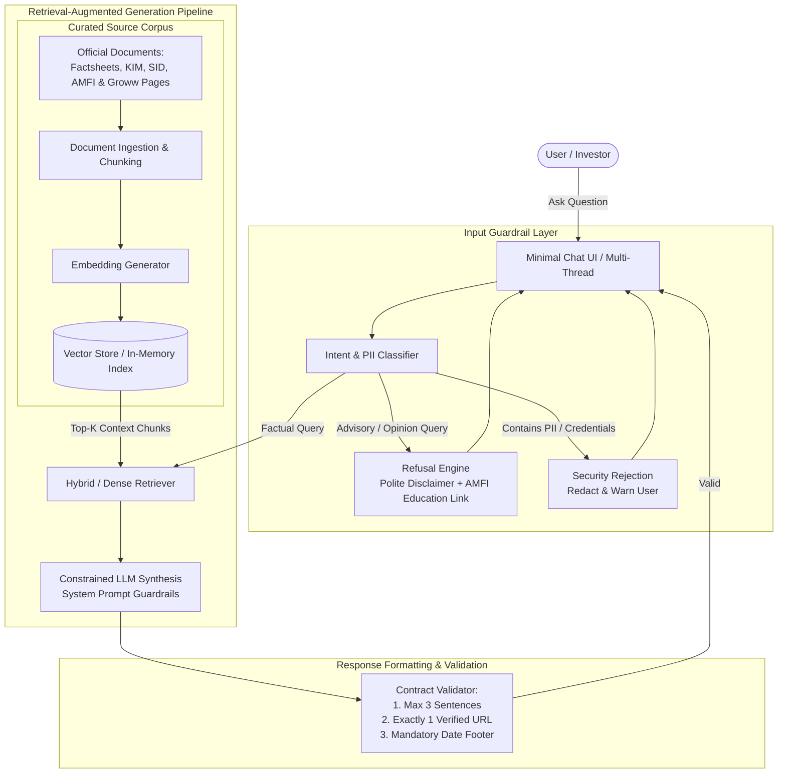

# 📊 Mutual Fund FAQ Assistant (Facts-Only Q&A) — Project Specification

> **Reference Context**: Groww-style Retail Mutual Fund Platform  
> **Core Principle**: *"Accuracy over Intelligence"* — Deterministic, factual, verifiable answers backed by official regulatory, AMC, and product reference sources.  
> **Primary Source**: Derived from [`problemStatement.txt`](./problemStatement.txt)

---

## 1. Overview & Problem Statement

In the retail mutual fund landscape (with platforms like **Groww** serving millions of users), investors and support representatives frequently need rapid, unambiguous, and verifiable answers to factual scheme queries — such as expense ratios, exit loads, minimum SIP amounts, lock-in terms, and statement download workflows.

However, standard generative AI solutions suffer from two critical hazards in financial domains:
1. **Hallucination & Speculation**: Generating incorrect figures, outdated fees, or assumed terms.
2. **Regulatory & Compliance Violations**: Inadvertently offering investment advice, subjective opinions ("*this is a great fund*"), or comparative rankings, violating SEBI (Securities and Exchange Board of India) and AMFI (Association of Mutual Funds in India) advisory regulations.

The objective of this project is to architect and implement a **lightweight Retrieval-Augmented Generation (RAG) FAQ Assistant**. The assistant acts as a strict facts-only retrieval engine that extracts answers exclusively from official, public regulatory and Asset Management Company (AMC) documents, enforcing deterministic guardrails, zero advisory bias, and mandatory single-source citation with update timestamps.

---

## 2. Core Objectives

- **Fact-Only Answering**: Answer objective, verifiable queries regarding mutual fund schemes without speculating, extrapolating, or offering subjective commentary.
- **Official Corpus Grounding**: Ground all responses in a curated, authoritative corpus of 15–25 official public URLs (Factsheets, KIM, SID, AMFI/SEBI guides, Groww reference pages).
- **Strict Formatting & Conciseness**: Enforce a strict response contract: maximum 3 sentences, exactly one citation link, and a standardized source update timestamp footer.
- **Robust Refusal Protocol**: Automatically identify and politely decline subjective, advisory, or comparative questions, redirecting users to official investor education portals.
- **Privacy & PII Protection**: Strictly reject, redact, and prevent processing of any Personally Identifiable Information (PAN, Aadhaar, account numbers, OTPs, phone numbers, email addresses).
- **Multi-Thread Interaction**: Support multiple independent chat sessions or threads simultaneously.

---

## 3. Target Users & Personas

| Persona | Description | Primary Needs |
|---|---|---|
| **Retail Investor** | Individual looking up mutual fund facts on platforms like Groww | Quick, accurate, factual clarity on fees (TER), exit loads, lock-in rules, riskometer levels, and tax report download steps without unwanted sales talk. |
| **Customer Support Team** | Frontline support executives handling high ticket volumes | Standardized, legally compliant responses to repetitive queries; instant citation links to share with customers. |
| **Content & Compliance Team** | Product content creators and compliance reviewers | Assurance that all automated messaging adheres strictly to SEBI guidelines with zero investment advisory liability. |

---

## 4. Scope of Work

### 4.1 Corpus Definition
The assistant is scoped to a specific, well-defined corpus focusing on **HDFC Mutual Fund** across 5 diversified schemes:

1. **Selected AMC**: **HDFC Mutual Fund** (Asset Management Company)
2. **Selected Schemes & Groww Reference URLs**:
   - **Mid-Cap Equity**: [HDFC Mid-Cap Opportunities Fund (Direct - Growth)](https://groww.in/mutual-funds/hdfc-mid-cap-fund-direct-growth)
   - **Small-Cap Equity**: [HDFC Small Cap Fund (Direct - Growth)](https://groww.in/mutual-funds/hdfc-small-cap-fund-direct-growth)
   - **Large-Cap Equity**: [HDFC Large Cap / Top 100 Fund (Direct - Growth)](https://groww.in/mutual-funds/hdfc-large-cap-fund-direct-growth)
   - **Precious Metals FoF**: [HDFC Silver ETF FoF (Direct - Growth)](https://groww.in/mutual-funds/hdfc-silver-etf-fof-direct-growth)
   - **Multi-Cap Equity**: [HDFC Multi Cap Fund (Direct - Growth)](https://groww.in/mutual-funds/hdfc-multi-cap-fund-direct-growth)

3. **Curated Public Source URLs (15–25 Official Links)**:
   - **Groww Scheme Pages (Reference Context)**:
     - `https://groww.in/mutual-funds/hdfc-mid-cap-fund-direct-growth`
     - `https://groww.in/mutual-funds/hdfc-small-cap-fund-direct-growth`
     - `https://groww.in/mutual-funds/hdfc-large-cap-fund-direct-growth`
     - `https://groww.in/mutual-funds/hdfc-silver-etf-fof-direct-growth`
     - `https://groww.in/mutual-funds/hdfc-multi-cap-fund-direct-growth`
   - **Official AMC (HDFC Mutual Fund) Primary Documents**:
     - Monthly Scheme Factsheets (latest published NAVs, AUM, TER, portfolio stats)
     - Key Information Memorandums (KIM)
     - Scheme Information Documents (SID)
     - HDFC AMC FAQ / Help & Customer Service Portal
   - **Regulatory & Educational Resources**:
     - AMFI India Guidance, Riskometer disclosures, and investor education portals
     - SEBI Investor Protection guidelines and circulars
   - **Operational Procedures**:
     - Official statement & Capital Gains / tax report download guides (Groww / HDFC AMC / CAMS / KFintech)

#### Disallowed Information Sources
| Allowed Sources (Strictly Official & Product Reference) | Prohibited Sources (Zero Tolerance) |
|---|---|
| Official AMC Portal (`hdfcfund.com`) | Third-party financial blogs / aggregators (Moneycontrol, Value Research, ET Money) |
| Groww Official Scheme Pages (Context Reference) | Unverified forums (Reddit, Quora, Twitter / X) |
| AMFI India Portal (`amfiindia.com`) | Scraping personal financial blogs or affiliate sites |
| SEBI Official Portal (`sebi.gov.in`) | Unofficial news articles or promotional press releases |
| Official RTA portals (CAMS / KFintech) for statement guides | Unverified influencer content or financial tip sheets |

---

### 4.2 Assistant Capabilities & Response Contract

#### Supported Factual Query Domains
- **Expense Ratio (TER)**: Direct vs. Regular plan Total Expense Ratio as per the latest factsheet.
- **Exit Load Structure**: Redemption fee tiers and tenure thresholds (e.g., *1% if redeemed within 365 days*).
- **Minimum Investment Limits**: Minimum initial lumpsum, additional purchase, and minimum SIP amount.
- **Lock-in Terms**: Statutory lock-in periods where applicable.
- **Risk & Benchmark**: Official SEBI Riskometer level (e.g., *Very High Risk*) and standard Benchmark Index (e.g., *NIFTY Midcap 150 TRI*).
- **Operational Procedures**: Step-by-step guidance to download account statements, holding certificates, or capital gains tax reports.

#### Strict Response Formatting Contract
Every single response from the assistant must satisfy the following 4 invariants:

```
[Sentence 1: Direct, concise answer to the factual query.] [Sentence 2: Supporting official context, condition, or tier details if applicable.] [Sentence 3 (Optional): Additional factual qualification or procedural instruction.]

Source: <Single Official Citation Link>
Last updated from sources: <YYYY-MM-DD>
```

1. **Sentence Limit**: **Maximum 3 sentences** (concise, direct, no preamble or fluff).
2. **Single Citation**: **Exactly one verified official citation link** directly pointing to the source document or official page.
3. **Standardized Footer**: Every answer must terminate with:  
   `Last updated from sources: <YYYY-MM-DD>`
4. **Zero Editorializing**: No adjectives such as "lucrative", "attractive", "safe", or "recommended".

---

### 4.3 Refusal Handling & Compliance Guardrails

The assistant must detect and strictly refuse advisory, opinionated, or comparative inquiries:

| Query Type | Example User Query | Compliant Behavior |
|---|---|---|
| **Recommendation** | *"Should I invest in this fund?"* | **Refuse**: State facts-only boundary + provide AMFI educational link. |
| **Comparative / Superlative** | *"Which fund is better: HDFC Mid-Cap or Small-Cap?"* | **Refuse**: Reiterate that comparisons cannot be provided + link to official scheme factsheets. |
| **Return Projections** | *"How much will ₹10,000 become in 5 years?"* | **Refuse / Factsheet link only**: Prohibit return calculations or projections; direct to factsheet historical table. |
| **Tax / Legal Counseling** | *"How can I evade tax on my mutual fund redemptions?"* | **Refuse**: Reiterate compliance boundary + link to official Income Tax / AMFI tax guidance. |

#### Refusal Response Blueprint
- Polite and non-confrontational tone.
- Clearly states: *"I can only provide objective, factual information regarding mutual fund schemes and cannot offer investment advice, comparisons, or recommendations."*
- Includes exactly one authoritative educational resource link (e.g., [AMFI Investor Education](https://www.amfiindia.com/investor-corner/knowledge-center)).
- Concludes with the mandatory timestamp footer.

---

### 4.4 Minimal User Interface (Groww-Inspired)

The interface must be lightweight, intuitive, and compliant:
1. **Welcome Header**: Clean intro banner highlighting the scope (HDFC Mutual Fund schemes).
2. **Prominent Visible Disclaimer**:
   > **⚠️ Disclaimer: Facts-only. No investment advice.**
3. **Three Interactive Example Questions**:
   - *"What is the exit load for HDFC Mid-Cap Opportunities Fund?"*
   - *"What is the minimum SIP amount for HDFC Small Cap Fund?"*
   - *"How do I download my Capital Gains statement on Groww?"*
4. **Multi-Thread / Multi-Session Manager**:
   - Sidebar or thread selector enabling users to switch between or spin up multiple independent conversation threads.
   - Isolated session state per thread.

---

## 5. Non-Functional & Security Constraints

```
┌────────────────────────────────────────────────────────────────────────┐
│                        COMPLIANCE & DATA BOUNDARIES                    │
├──────────────────────────────┬─────────────────────────────────────────┤
│ Data Integrity               │ Only AMC / AMFI / SEBI & Groww sources  │
│ PII Protection               │ Zero PAN, Aadhaar, Folio, OTP ingestion │
│ Regulatory Standard          │ SEBI (Investment Advisers) Regs 2013     │
│ Response Latency             │ < 2.5s end-to-end response time         │
│ Hallucination Tolerance      │ 0% tolerance for ungrounded numericals  │
└──────────────────────────────┴─────────────────────────────────────────┘
```

- **Privacy & PII Firewall**:
  - The system must reject, mask, or refuse queries containing sensitive financial PII (PAN cards, Aadhaar IDs, Bank Account numbers, Folio numbers, OTPs, mobile numbers, passwords).
  - Explicit warning: *"Please do not share sensitive financial information such as PAN or account numbers."*
- **No Third-Party Unverified Blogs**: Scraping random financial blogs or unvetted aggregators is strictly forbidden.
- **Auditability**: Every generated token must be traceable back to a source chunk with an exact URL and document version date.

---

## 6. Architecture & System Workflow



---

## 7. Deliverables Checklist

- [ ] **Curated Corpus Definition**: HDFC Mutual Fund and 5 diversified schemes with 15–25 documented official public URLs.
- [ ] **RAG Knowledge Base & Ingestion**: Pipeline to extract, chunk, and embed official documents/pages.
- [ ] **Backend Service**:
  - Semantic search / retrieval engine.
  - Strict system prompt enforcing facts-only, sentence caps, single citation, and refusal triggers.
  - Multi-session / thread state management.
- [ ] **Minimal Frontend UI**:
  - Clean Groww-inspired theme (dark/light, high-contrast, emerald accents, WCAG 2.1 AA compliant).
  - Prominent disclaimer: `“Facts-only. No investment advice.”`
  - Welcome message with 3 clickable preset starter prompts.
  - Multi-thread conversation switcher.
- [ ] **Project Documentation (`README.md`)**:
  - Comprehensive local setup and execution instructions.
  - Architecture breakdown and retrieval strategy.
  - List of selected AMC schemes and source URLs.
  - Known limitations and future enhancements.

---

## 8. Success Criteria & Evaluation Metrics

| Metric | Target | Measurement Method |
|---|---|---|
| **Factual Retrieval Accuracy** | ≥ 98% | Grounded verification against official AMC factsheet tables. |
| **Hallucination Rate** | 0.0% | Zero claims generated outside retrieved context chunks. |
| **Response Contract Adherence** | 100% | Exact compliance with: ≤ 3 sentences, 1 citation link, valid footer. |
| **Advisory Refusal Recall** | 100% | 100% rejection rate for advice, rating comparisons, or stock picking queries. |
| **PII Leakage Prevention** | 100% | Complete masking or refusal when user submits PAN, Aadhaar, or account info. |
| **Latency** | < 2.5s | End-to-end turnaround time for query answering. |

---

## 9. Summary

The **Mutual Fund FAQ Assistant** is built on a non-negotiable principle: **trust through verifiable facts**. In an industry where unauthorized financial advice carries severe regulatory penalties and real user risk, this system trades speculative conversational flair for deterministic, verified precision. Users receive rapid, accurate, source-backed answers to their mutual fund questions, anchored strictly in official public data.
